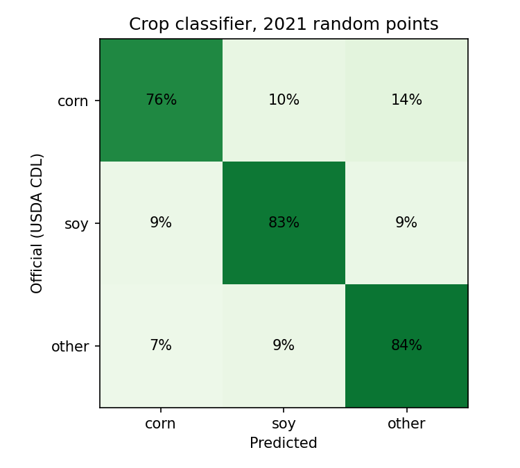
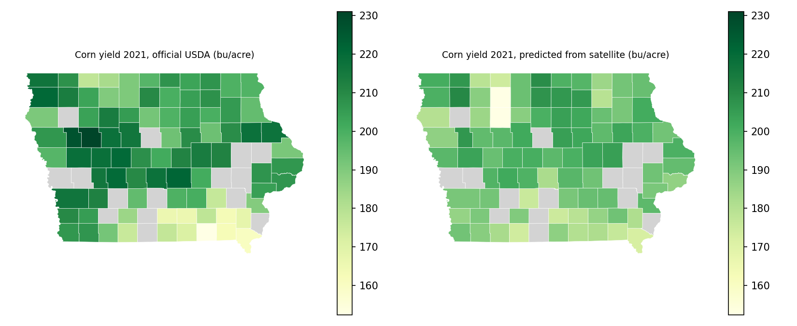
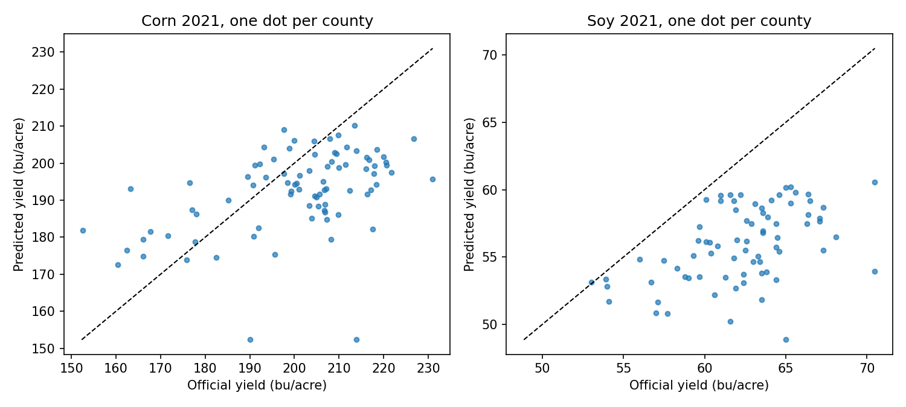

# Field to Yield

I wanted to see how far I could get from raw satellite imagery to a county yield estimate using only free data. This repo does that for Iowa corn and soybeans in two stages. First a classifier labels what is growing at each point (corn, soybean or other) from Sentinel 2 greenness and moisture readings. Then the predicted crop area for each county feeds a yield model.

## Results

All results are on 2021, a year the models never saw. Training used 2018 to 2020.

### Stage 1: crop classifier

| Model | Accuracy |
|---|---|
| Random forest, NDVI only | 74.2% |
| Random forest, NDVI and NDMI | 80.5% |
| 1D CNN, NDVI and NDMI | 81.2% |

I tested on 2,959 balanced points. On 19,806 random 2021 points with the real crop mix, the CNN reaches 80.7% accuracy, with corn recall of 76% and soybean recall of 83%. The biggest gain came from adding NDMI, a moisture index: the random forest went from 74.2% to 80.5%. Predicted county crop shares correlate with the official USDA shares at 0.71 for corn and 0.63 for soybeans in 2021.



### Stage 2: county yield (2021, RMSE in bushels per acre, lower is better)

| Crop | County average baseline | Satellite features | Satellite plus county average |
|---|---|---|---|
| Corn (84 counties) | 18.96 | 16.95 | 16.74 |
| Soybean (75 counties) | 8.51 | 7.17 | 6.98 |

I also tried an in season forecast that only uses data up to early August. It gave corn 17.81 and 17.82 and soybean 6.71 and 6.78 for the two satellite models, against the same baselines. With a single test year I would not read much into how that compares with the full season runs.




## Limitations

- I have one test year and three training years. The yield models beat the baseline on error, but R2 is near zero for corn and negative for soybeans, so they do not rank counties well within a year. Treat this as a working pipeline, not a finished forecast.
- I read imagery at 80 m resolution to keep downloads practical. About 80 percent of half month readings were available because of clouds, and I fill the gaps by linear interpolation.
- Labels come from the USDA Cropland Data Layer, which has its own errors.
- I did not use weather data.

## How it works

1. I sample random points across Iowa and label them with the USDA Cropland Data Layer for 2018 to 2021: 1,000 per class per year for training, plus 20,000 unfiltered points per year for county crop shares.
2. For each point I read Sentinel 2 L2A scenes from June to September, mask clouds with the scene classification band, and take the median NDVI and NDMI in half month steps.
3. A random forest and a 1D CNN classify each point as corn, soybean or other.
4. For each county, the predicted crop share plus the mean NDVI and NDMI of points predicted as that crop go into a gradient boosting model for yield. I compare it with a county average baseline.

## Reproduce

You need a free [USDA NASS API key](https://quickstats.nass.usda.gov/api) saved in `key.txt`.

```
pip install -r requirements.txt
python get_yield.py
python get_counties.py
python sample_points.py
python area_points.py
python fetch_ndvi2.py
python train_classifier2.py
python classify_area.py
python yield_model.py
python yield_model.py 5
python make_figures.py
```

`fetch_ndvi.py` and `train_classifier.py` are my first baseline version. `area_points.py` is `sample_points.py` with 20,000 points per year, no class cap and a different random seed.

## Data sources

- [Sentinel 2 L2A on Microsoft Planetary Computer](https://planetarycomputer.microsoft.com/dataset/sentinel-2-l2a)
- [USDA Cropland Data Layer on Planetary Computer](https://planetarycomputer.microsoft.com/dataset/usda-cdl)
- [USDA NASS Quick Stats county yields](https://quickstats.nass.usda.gov/)
- [US Census county boundaries](https://www.census.gov/geographies/mapping-files/time-series/geo/carto-boundary-file.html)